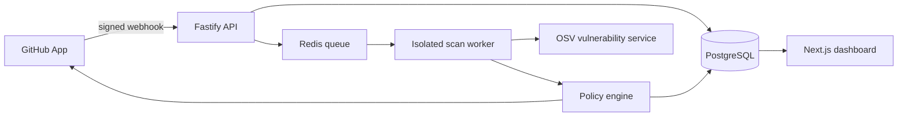

# SupplyChain Shield

**Developer-first software supply chain security for small teams.**

[](https://github.com/rumbletomb/supplychain-shield/actions/workflows/ci.yml)
[](LICENSE)
[](package.json)

SupplyChain Shield is a self-hosted GitHub App that reviews every pull request for vulnerable
dependencies, leaked credentials, insecure Dockerfiles, and unsafe GitHub Actions. It applies a
repository policy, publishes actionable GitHub Checks, and retains an auditable report without
keeping customer source code.

> The project is production-minded and fully usable as a self-hosted v0.1 release. It deliberately
> avoids executing code from scanned repositories.

## Why it exists

Small teams often need more than a collection of disconnected command-line scanners, but less than
an enterprise application-security platform. SupplyChain Shield provides one installation, one
policy, and one focused report in the pull-request workflow.

## Capabilities

| Capability | Current release |
| --- | --- |
| Vulnerable dependencies | npm lockfiles and pinned Python requirements through OSV |
| Credential detection | Private keys, GitHub tokens, AWS keys, and generic credentials |
| Container configuration | Root containers, mutable tags, and unsafe remote `ADD` |
| GitHub Actions | Broad token permissions and unpinned third-party actions |
| Policy enforcement | Block/warn thresholds, ignored rules, and time-bound exceptions |
| GitHub integration | Signed webhooks, short-lived installation tokens, and Checks annotations |
| Reports | JSON, SARIF 2.1.0, and CycloneDX 1.6 |
| Operations | PostgreSQL, Redis/BullMQ, health endpoint, audit events, and Docker Compose |

## Architecture



The API acknowledges webhooks quickly and queues immutable scan jobs. The worker downloads a
commit archive to a restricted temporary directory, performs static analysis, persists only
findings and metadata, publishes a Check Run, and destroys the source directory.

Read the full [architecture](docs/architecture.md) and [security model](docs/security-model.md).

## Quick start

### Requirements

- Docker Desktop with Docker Compose, or Node.js 22+, pnpm, PostgreSQL 17, and Redis 7.
- A GitHub App only for live repository integration. The demo works without GitHub credentials.

### Start the local demonstration

```bash
cp .env.example .env
docker compose up --build
```

Open [http://localhost:3000](http://localhost:3000), choose **Run demo scan**, and inspect the
deliberately vulnerable fixture. The API is available on port `4000` and exposes a health check at
`/health`.

The fixture contains only synthetic examples. Its credential-like value is intentionally fake.

### Local development

```bash
corepack enable
pnpm install
docker compose up -d postgres redis
pnpm db:migrate
pnpm db:seed
pnpm dev
```

Run the quality gates before opening a pull request:

```bash
pnpm lint
pnpm typecheck
pnpm test
pnpm build
```

## Connect a GitHub App

Create a GitHub App with these repository permissions:

- Checks: read and write.
- Contents: read-only.
- Pull requests: read-only.
- Metadata: read-only.

Subscribe to `pull_request`, `installation`, and `installation_repositories`. Point the webhook URL
to `https://your-domain.example/webhooks/github`, generate a private key, then set:

```dotenv
GITHUB_APP_ID=123456
GITHUB_PRIVATE_KEY_BASE64=<base64-encoded-pem>
GITHUB_WEBHOOK_SECRET=<at-least-32-random-characters>
WEB_URL=https://shield.example.com
```

Never commit a PEM file or the encoded private key. See the complete
[GitHub App setup guide](docs/github-app-setup.md).

## Policy API

Each repository receives a secure default policy: block at `high`, warn at `medium`, and always
block detected credentials. Update it through:

```http
PUT /api/repositories/:id/policy
Content-Type: application/json

{
  "blockAt": "high",
  "warnAt": "medium",
  "blockVerifiedSecrets": true,
  "deniedLicenses": ["AGPL-3.0"],
  "ignoredRules": []
}
```

Exceptions require a reason, approver, and future expiration date. Every policy change and
exception produces an audit event.

## Repository structure

```text
apps/
  api/       Webhooks, REST API, policy management and job creation
  web/       Operations and findings dashboard
  worker/    Temporary repository acquisition and scan orchestration
packages/
  contracts/ Runtime schemas and shared types
  core/      Scanners, policy engine and report generation
  database/  Prisma model and migrations
  github/    GitHub App authentication and Checks publishing
fixtures/    Safe deliberately vulnerable repositories
docs/        Architecture, operations, security and integration guides
```

## Security principles

- Least-privilege GitHub App permissions.
- HMAC verification before accepting webhook payloads.
- Short-lived installation credentials.
- No package installation or execution of repository code.
- Source archives removed after every scan, including failures.
- Secrets redacted before findings are stored or logged.
- Stable finding fingerprints and expiring, auditable exceptions.
- Pinned scanner and runtime versions in reproducible containers.

Please report vulnerabilities privately according to [SECURITY.md](SECURITY.md).

## Roadmap

- Container-image scanning without building untrusted images.
- License discovery and allow/deny policy packs.
- Scheduled default-branch scans.
- Organization SSO and role-based administration.
- GitLab and Azure DevOps providers.
- Signed release images and Helm deployment.

## Contributing

Contributions are welcome. Read [CONTRIBUTING.md](CONTRIBUTING.md), add tests for behavioral
changes, and keep scanner output deterministic. The fixture directory is the only place where
synthetic vulnerable examples should be committed.

## License

MIT © 2026 SupplyChain Shield contributors.

